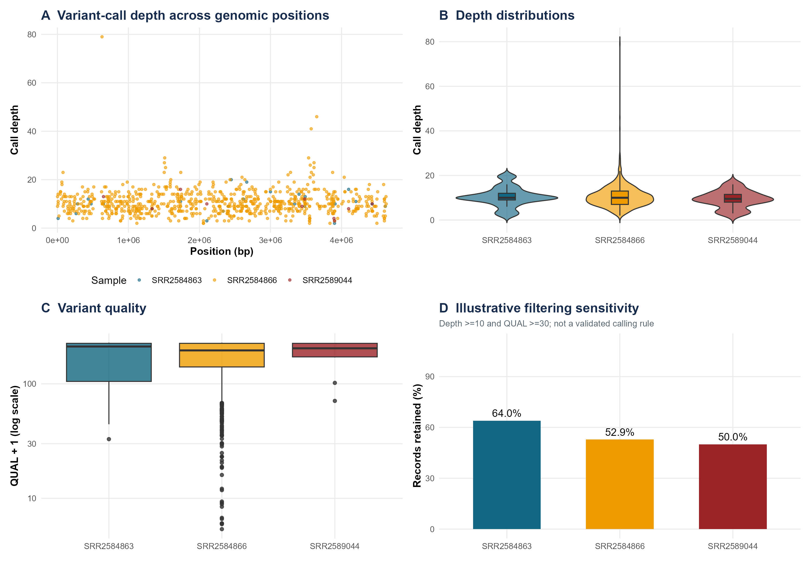
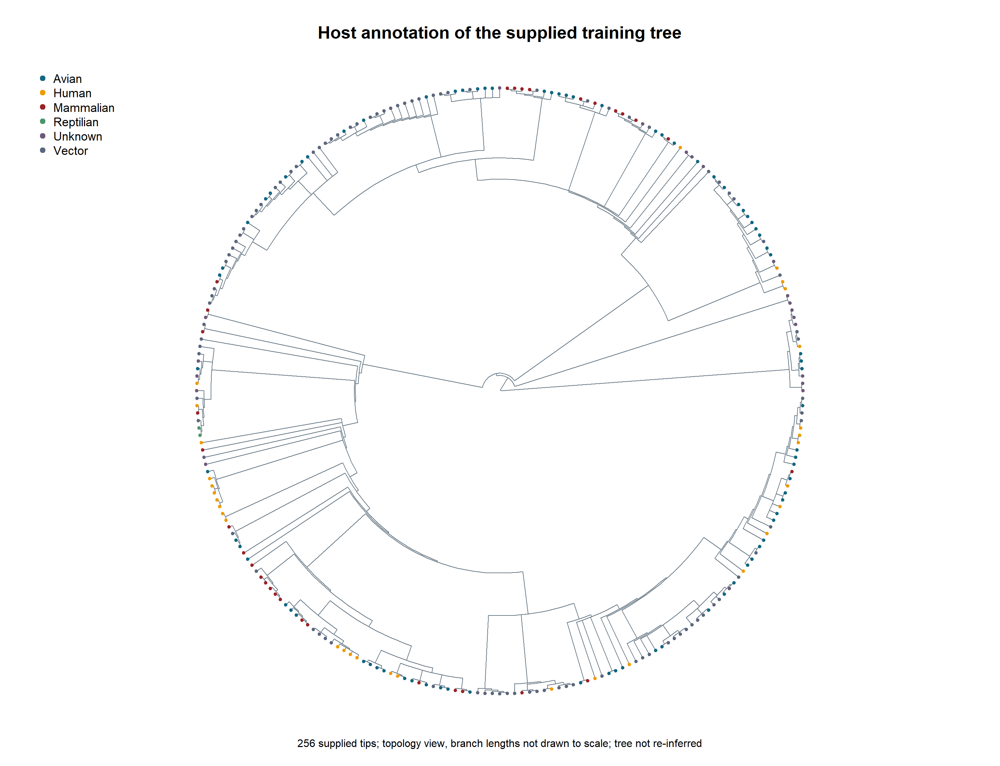
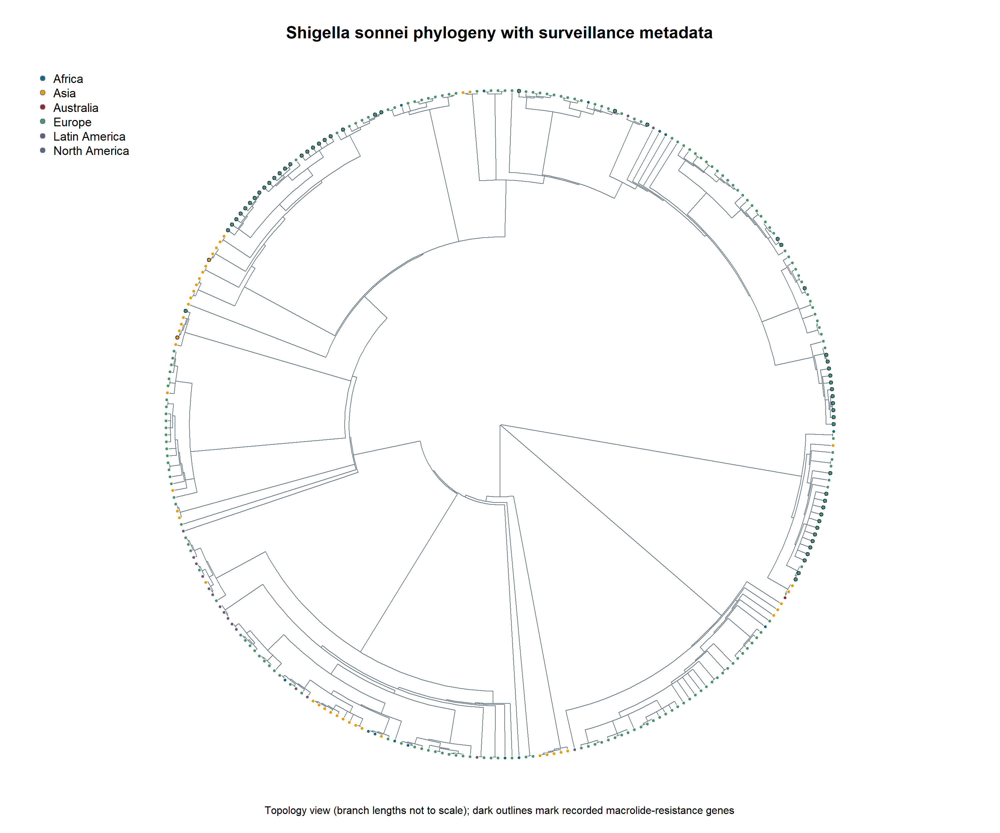
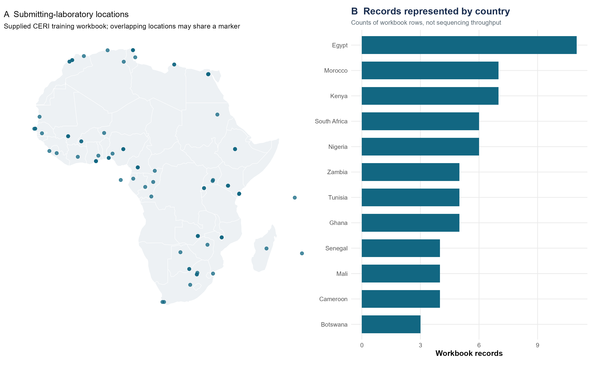
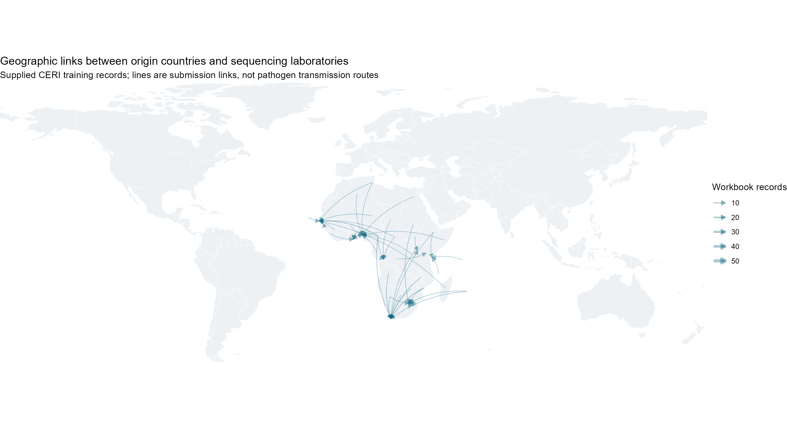
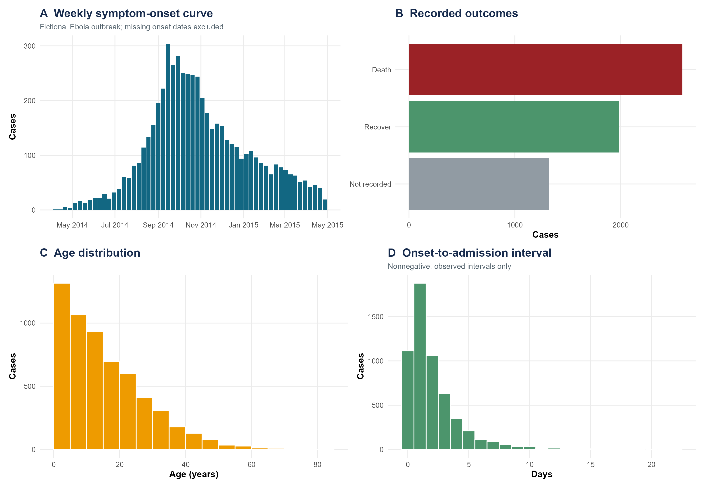
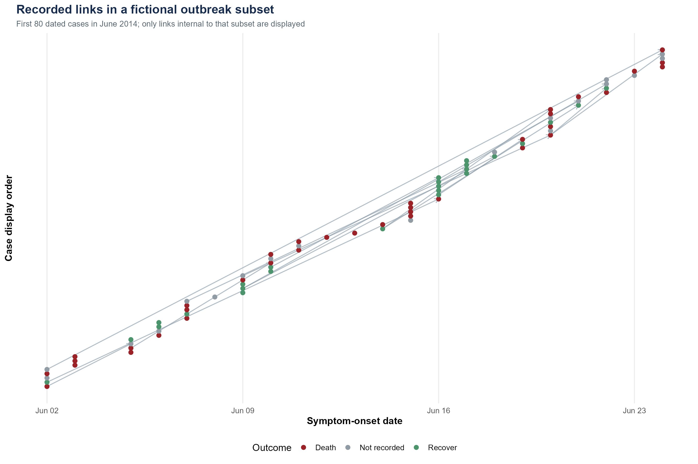

# Genomic and Spatial Surveillance in R

**Vusumuzi Mabasa and Sibusiso Mahlangu**  
Joint analytical work developed during CERI training, consolidated into a reproducible research portfolio.

## Overview

Genomic surveillance combines molecular measurements, phylogenetic context, sampling geography and epidemiological information. This repository presents four complementary applications developed from our CERI training work: genomic variant visualisation, phylogenetic annotation, spatial characterisation of sequencing submissions and descriptive outbreak epidemiology. The applications use distinct datasets and do not constitute a single linked patient cohort.

The original practicals have been refactored into executable R scripts with relative paths, explicit data checks, reproducible figures and exported results. The repository contains published example data, supplied training datasets shared with permission, and a **fictional Ebola line list**. Results are interpreted according to those different sources. No new sequencing, variant calling or phylogenetic inference was undertaken in this reanalysis.

## Data and analytical scope

| Application | Data | Interpretation |
|---|---|---|
| Genomic visualisation | Data Carpentry variant-call table, 801 records across 3 samples | Descriptive assessment of existing calls; not FASTQ-level quality control |
| Supplied training tree | 256 tips and 275 metadata records | Annotation of the supplied topology; no new tree inference or dating |
| Published Shigella tree | 299 samples and associated surveillance annotations | Reanalysis of a published example, including Belgian and international samples |
| Sequencing geography | 103 location records and 125 submission-link records | Description of supplied workbook entries; not a census of African sequencing capacity |
| Outbreak epidemiology | 5888 fictional Ebola cases | Reproduction of a training example, not observations from actual patients |

The [data manifest](data/README.md) identifies sources, permissions and licenses. Public downloads are pinned to upstream commit identifiers in [pinned_sources.json](references/pinned_sources.json); the complete input inventory records SHA-256 fingerprints in [input_manifest.csv](references/input_manifest.csv). The downloaded Ebola line list differs from the local file in binary serialization but was verified to have equivalent data-frame content.

## Methods

### Genomic variant profiles

Records were checked for required fields, valid positions, nonnegative depths and duplicated sample-specific allele keys. Variant-call depth and QUAL were summarised separately for each sample. An illustrative filter retained records with depth at least 10 and QUAL at least 30:

$$I_i = \mathbf{1}\{DP_i\geq10\;\land\;QUAL_i\geq30\},\qquad r_s=\frac{\sum_{i\in s}I_i}{n_s}.$$

These cutoffs demonstrate filtering sensitivity. They are not validated thresholds for clinical use, and retention does not establish variant accuracy. Summaries refer to positions represented in the variant table rather than genome-wide coverage.

### Phylogenetic annotation

Existing Nexus and Newick trees were imported using `ape`. Branch lengths were checked for finite, nonnegative values. Each displayed tip was required to match exactly one metadata identifier. The supplied metadata file contained an invisible byte-order mark in its first column name; import now handles that explicitly. Metadata were reordered to the tree-tip order before annotation.

The main circular figures show **topology with branch lengths not drawn to scale**, improving visibility of metadata patterns. Original branch lengths remain available in the source trees and the [full phylograms](results/figures/full_branch_length_phylograms.pdf). Host labels annotate the training tree; continent and recorded macrolide-resistance gene annotations describe the Shigella example. A missing gene annotation is treated as unrecorded, not as proof of susceptibility. Tree proximity alone is not interpreted as a direct transmission link, and no clustering test was performed.

### Spatial surveillance

Laboratory coordinates were parsed as numeric longitude and latitude and checked for missingness, geographic bounds and zero/zero placeholders. Repeated country–laboratory–coordinate combinations were counted once in the point map. Natural Earth boundaries provide cartographic context. Planar plotting-ring validity was checked with GEOS; no spherical distance, area or spatial association statistic was estimated.

Submission links connect the supplied origin-country coordinates to sequencing-laboratory coordinates. They are administrative/sample-submission links, not reconstructed journeys or pathogen transmission routes. A separate historical country-level choropleth reproduces a handbook mapping example. Its values are presented as illustrative training inputs, not current or independently verified COVID-19 estimates. Unmatched country/territory labels remain explicit in the [matching audit](results/tables/historical_map_country_matching.csv).

### Fictional outbreak epidemiology

Cases were aggregated by Monday-starting week of symptom onset. Missing onset dates were retained in the completeness audit and excluded from the epidemic curve. Age and onset-to-admission intervals were summarised descriptively; negative intervals were audited separately rather than silently corrected.

The proportion recorded as deceased among cases with known outcomes was

$$\hat p=\frac{D}{D+R},$$

where $D$ and $R$ denote recorded deaths and recoveries. The 95% Wilson interval used $z=1.96$:

$$\frac{\hat p+z^2/(2n)\;\pm\;z\sqrt{\hat p(1-\hat p)/n+z^2/(4n^2)}}{1+z^2/n},\qquad n=D+R.$$

This conditional proportion is not a censoring-adjusted fatality estimate. Missing outcomes can change its interpretation. Transmission links were taken from the supplied fictional infector field; no contacts or exposure attributes were invented. Links referencing absent case identifiers were counted and excluded from the displayed network. A deterministic subset of the first 80 dated cases in June 2014 was used for visual readability.

## Results

### Genomic profiles and illustrative filtering

The variant table contained **801 records from 3 samples**. The illustrative depth/quality filter retained **426 records (53.2%)**. Sample-specific summaries show that the number and depth of represented calls differ between samples; these differences concern the supplied call table and do not establish genome-wide completeness or biological differences in mutation rates.

| sample_id | records | median_depth | median_QUAL | retained | retained_percent |
| --- | --- | --- | --- | --- | --- |
| SRR2584863 | 25 | 10.0 | 211.0 | 16 | 64.00 |
| SRR2584866 | 766 | 10.0 | 195.0 | 405 | 52.87 |
| SRR2589044 | 10 | 9.5 | 204.5 | 5 | 50.00 |



### Phylogenetic metadata integration

All **256 training-tree tips** matched metadata after column-name normalisation. **19 additional metadata records** had no corresponding tip in this supplied tree and were excluded from its annotations. The matched tips represented 6 host categories. The figure makes those recorded categories visible while retaining the supplied topology; it does not demonstrate host adaptation or transmission.

| dataset | tree_tips | metadata_rows | matched_tips | unused_metadata |
| --- | --- | --- | --- | --- |
| Training tree | 256 | 275 | 256 | 19 |
| Shigella | 299 | 299 | 299 | 0 |



All **299 Shigella tips** matched their published metadata. The metadata represented **17 country/location labels**, and **57 samples** had a recorded macrolide-resistance gene annotation. Differences between continents are descriptive features of this selected published dataset; neither sampling representativeness nor independent geographic clustering was established.

| Continent | tips | macrolide_gene_recorded |
| --- | --- | --- |
| Africa | 14 | 0 |
| Asia | 45 | 2 |
| Australia | 1 | 0 |
| Europe | 222 | 55 |
| Latin America | 16 | 0 |
| North America | 1 | 0 |



### Sequencing locations and submission links

The location workbook contained **103 records across 37 countries**. Coordinates were usable for **102 records**, yielding **102 distinct country–laboratory–coordinate combinations**. One record lacked usable coordinates. The map therefore describes represented locations rather than national sequencing throughput, access or surveillance completeness.



All **125 submission-link records** had usable origin and destination coordinates. The supplied flow workbook contained **125 cross-border entries**. That concentration reflects the selected workbook and cannot be interpreted as the proportion of all African sequencing performed internationally.

| SequencingContinent | records | cross_border |
| --- | --- | --- |
| Africa | 125 | 125 |



The separate historical mapping exercise matched **160 of 238 table entries** to the coarse Natural Earth boundary layer. The table also includes aggregate/territory labels not represented by that layer. Its [choropleth](results/figures/historical_country_mapping.png) and complete matching table are retained as supplementary outputs.

### Fictional epidemic characteristics and incomplete contact links

Of **5888 fictional cases**, **5632 had recorded onset dates** and **256 did not**. The epidemic curve peaked at **304 cases** in the week beginning **2014-09-15**. The median observed nonnegative onset-to-admission interval was **1 day(s)**; the audit found **0 negative intervals**.

The file contained **2582 recorded deaths**, **1983 recoveries** and **1323 missing outcomes**. Among cases with known outcomes, the recorded death proportion was **56.6% (95% Wilson CI 55.1–58.0%)**. Because the example is fictional and outcomes are incomplete, this number is a demonstration of denominator-aware reporting rather than an estimate for an actual Ebola outbreak.

| outcome | cases | percent |
| --- | --- | --- |
| Death | 2582 | 43.85 |
| Not recorded | 1323 | 22.47 |
| Recover | 1983 | 33.68 |



The supplied infector field contained **3800 links**, of which **2161 had both endpoints in the cleaned line list**. The remaining **1639 referenced an identifier absent from that file**. Complete contact-network reconstruction is therefore not supported by the cleaned file alone. The displayed 80-case subset contains **15 internal matched links**; missing links are not imputed.



## Quality control and reproducibility

The completed run passed **21 explicit checks**, covering input schema, genomic-record uniqueness, retention bounds, tree identifiers, branch lengths, metadata joins, plotting geometries, coordinate inputs, weekly count reconciliation and transmission-link accounting. A passing check means the stated condition was met; it does not mean the source datasets are complete or representative. Missing onset dates, unused metadata, unmapped geography and unmatched contact identifiers remain visible in the results.

See [qc_checks.csv](results/tables/qc_checks.csv), [outbreak_missingness.csv](results/tables/outbreak_missingness.csv), [outbreak_link_qc.csv](results/tables/outbreak_link_qc.csv) and [package_versions.csv](results/tables/package_versions.csv).

### Run the analyses

From the repository root, with R installed:

```bash
Rscript scripts/install_dependencies.R
Rscript scripts/run_all.R
Rscript scripts/build_docs.R
Rscript scripts/verify_outputs.R
```

The first command installs missing dependencies from CRAN. `run_all.R` regenerates the figures and tables. `build_docs.R` regenerates this README, a self-contained HTML research report and the outbreak dashboard; HTML rendering requires Pandoc, supplied with RStudio or Quarto. To use the recorded package versions instead of current CRAN releases:

```r
install.packages("renv")
renv::restore(lockfile = "renv.lock", prompt = FALSE)
renv::load()
source("scripts/run_all.R")
source("scripts/build_docs.R")
```

PNG figures are embedded directly above for GitHub viewing. Vector PDF versions are in [results/figures](results/figures). The rendered [HTML report](results/reports/surveillance_report.html) and [outbreak dashboard](results/reports/outbreak_dashboard.html) can be downloaded and opened locally; GitHub's file viewer does not execute these HTML applications.

## Discussion

The applications illustrate how reproducible surveillance reporting benefits from clear separation of molecular observations, metadata integration, geography and epidemiological denominators. The same repository can support these complementary activities without suggesting that separate example datasets describe one shared outbreak.

The principal limitations are inherited from the source materials. Variant-table summaries cannot substitute for raw-read quality control or a validated calling pipeline. Supplied phylogenies do not provide new evolutionary inference, and annotated gene records do not by themselves establish a resistance phenotype. Laboratory maps reflect selected workbook entries and approximate location fields. Fictional case data demonstrate analytical procedures without providing evidence about real patients. Finally, the cleaned outbreak file contains incomplete infector references, restricting contact-network interpretation.

## Conclusion

The refactored project provides a reproducible account of our joint CERI training work, with inspectable R code, traceable data, explicit quality checks and interpretable figures and tables. Its contribution is a transparent surveillance-analysis portfolio whose results remain proportionate to the data and methods used.

## Authorship and acknowledgements

**Vusumuzi Mabasa and Sibusiso Mahlangu** jointly developed the original training work. This repository records its consolidated rerun and reporting. We acknowledge CERI's training programme and instructors, including **J. Poongavanan**, credited in the supplied visualisation practical. This personal portfolio does not imply institutional endorsement.

Upstream materials include [Data Carpentry's genomics R materials](https://github.com/datacarpentry/genomics-r-intro), [The Epidemiologist R Handbook](https://www.epirhandbook.com/en/new_pages/data_used.html), its contributors, and the authors/data providers of the published Shigella example. The latter is described in [Fischer et al., *Journal of Antimicrobial Chemotherapy*](https://doi.org/10.1093/jac/dkab377). Dataset-specific acknowledgements and terms are retained in [data/README.md](data/README.md) and [LICENSE.md](LICENSE.md).

## Repository organisation

```text
analyses/              Four complementary analysis modules
R/                     Shared plotting, validation and summary functions
scripts/               Dependency setup, execution, documentation and verification
dashboard/             R Markdown outbreak-dashboard source
data/example/          Selected public and permission-cleared training inputs
references/            Source revisions, input hashes and README template
results/figures/       PNG and vector PDF visualisations
results/tables/        Machine-readable summaries and QC audits
results/reports/       HTML research report, dashboard and R session information
renv.lock              Recorded dependency versions
```
